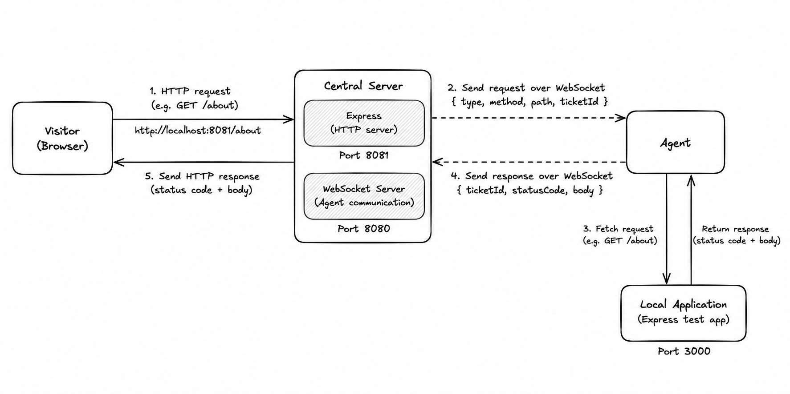

# P2P Host

P2P Host is an experimental hosting platform built to explore distributed systems by implementing the request-routing path from scratch. A visitor sends an HTTP request to a central Express server, which assigns a ticket ID and forwards the request to a connected agent over WebSocket. The agent fetches the requested route from an application running locally on its machine and sends the status code and response body back to the central server, which completes the original HTTP response. The current version is a working prototype; future goals include supporting multiple agents, load balancing, failure handling, and consistent hashing.

## Architecture



Current local ports:

- `3000` — sample application (`testapp`)
- `8080` — central WebSocket server (`server`)
- `8081` — central HTTP server for visitors (`server`)

## Run locally

Run each component in a separate terminal from the repository root. Make sure dependencies are installed in each folder first (`npm install`).

### Terminal 1 — Sample application

```bash
cd testapp
npm install
node index.js
```

The sample app should be available at `http://localhost:3000`.

### Terminal 2 — Central server

```bash
cd server
npm install
node index.js
```

This starts the WebSocket server on port `8080` and the visitor-facing HTTP server on port `8081` (as configured in the current prototype).

### Terminal 3 — Agent

```bash
cd agent
npm install
node index.js
```

The agent connects to the central WebSocket server and handles requests by fetching them from the local sample app.

## Test the request flow

With all three processes running, open this URL in your browser:

```text
http://localhost:8081/about
```

The central server should forward the request to the agent, retrieve the response from the sample app, and return it to your browser.

## Current status

- [x] Route a visitor request through the central server to a connected agent
- [x] Fetch the route from a locally running application
- [x] Return the agent's response to the original visitor request
- [ ] Handle request timeouts and agent disconnections robustly
- [ ] Route requests across multiple agents
- [ ] Implement and evaluate load-balancing strategies
- [ ] Implement consistent hashing and test agent join/leave behavior

## Learning goal

This project is a hands-on way to learn distributed systems concepts—including request routing, asynchronous communication, correlation IDs, failure handling, load balancing, and consistent hashing—by building and testing them incrementally.
